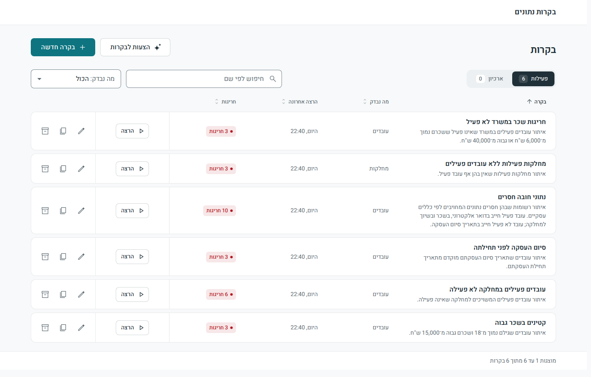
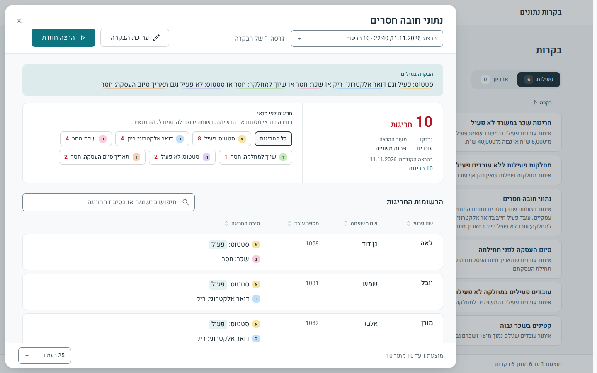
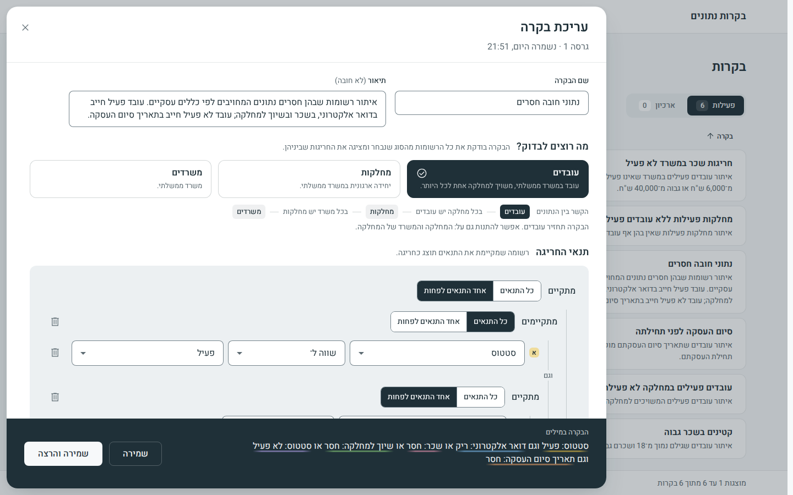
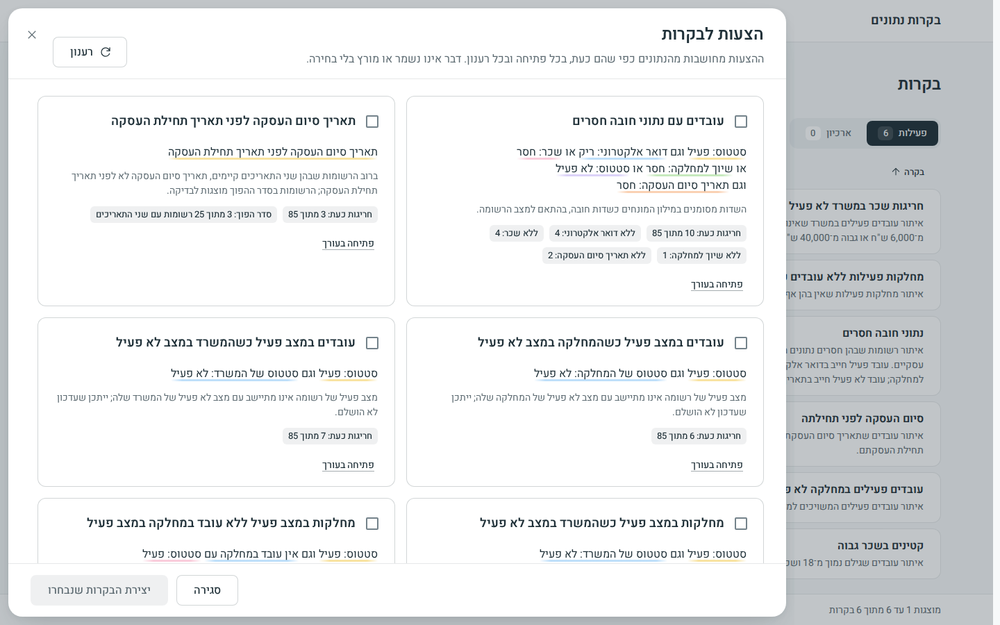
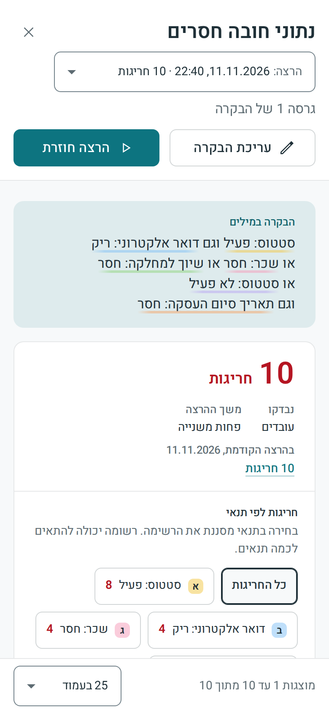

# Data Controls

**עברית: [דף ההגשה](docs/submission.he.md)** (what was submitted and where each deliverable is, in Hebrew).

Generic data-quality controls for business users. A user builds a rule from business terms in a Hebrew
interface, the engine compiles it into one parameterized SELECT, and the records that break the rule come back
with a reason each. The system only reads the organization's data.



## What the system is

An organization holds business data, and rules about that data change all the time: an employee under 18 should
not earn more than 15,000, a termination date cannot come before the hire date, an active employee cannot
belong to an inactive department. The people who know these rules know what the data means. They do not know
SQL, the tables or how the tables connect.

Here such a person builds a **control**: a named rule, made of business terms picked from lists (employee,
salary, "the department of the employee"), operators and values, joined by "and" and "or". Nothing in the
interface names a table or a column. The system stores the rule as a small JSON document, translates it into
one safe query when it runs, and shows the **violations**: every record that matches, with the reason it was
flagged, in Hebrew. Results can be searched, filtered by condition, sorted and compared with the previous run.

A new control needs no code, and no query is written or stored for it. A new field, entity or relationship is
an edit of one file, the business glossary, and reaches every picker of the interface from there. The part that
builds the query can only read the organization's data, and the part that can write never touches it.

## Architecture

```
 Browser: Angular client (Hebrew, right to left)
    |   JSON over HTTP, /api/v1
    v
 .NET 10 Web API (also serves the client)        login dq_app: reads and writes schema dq only
    |   JSON over HTTP, internal: definitions go down, records and reasons come back
    v
 Python FastAPI control engine                   login dq_engine_ro: SELECT on schema hr only
    |   validate -> compile one parameterized SELECT -> run -> explain
    v
 SQL Server 2022:  hr (the organization's data, never written)  ·  dq (controls, versions, runs, results)
```

The short description of the architecture and of how a control becomes a query is
[docs/summarize-architecture.md](docs/summarize-architecture.md); the long reference is
[docs/architecture.md](docs/architecture.md).

## Run with Docker

Needs Docker with Compose v2 (Docker Desktop on Windows and macOS). Nothing else is installed on the machine.

| | Command, from the repository folder |
|---|---|
| Linux, macOS, WSL | `scripts/start.sh` |
| Windows | `start.cmd` (double-click it, or run it in a command prompt) |

The script checks that Docker answers, creates `.env` with three random passwords when there is none (an
existing `.env` is never changed), builds and starts the containers, waits until the app is healthy and prints
the address:

```
Data Controls is running.

  The app            http://localhost:5000
  The api's pages    http://localhost:5000/api/docs
  The database       127.0.0.1,14330 (SQL Server; the logins and their passwords are in .env)
```

The first start downloads the base images (SQL Server alone is 2.2 GB) and builds two images, so its length
depends on the connection: allow several minutes. With the base images already downloaded, the build and the
start took 2 minutes on the development machine. A later start takes about half a minute.

**What appears.** The list at http://localhost:5000 holds six example controls, ready to run and never run. Run
each one with its button; on the sample data they find:

| Control (its name in the list) | Example file | Violations |
|---|---|---|
| קטינים בשכר גבוה | `minor-high-salary` | 3 |
| סיום העסקה לפני תחילתה | `termination-before-hire` | 3 |
| עובדים פעילים במחלקה לא פעילה | `active-in-inactive-department` | 6 |
| נתוני חובה חסרים | `missing-mandatory-data` | 10 |
| מחלקות פעילות ללא עובדים פעילים | `department-without-active-employees` | 3 |
| חריגות שכר במשרד לא פעיל | `inactive-ministry-salary-out-of-range` | 3 |

[docs/examples.md](docs/examples.md) lists the flagged records and their reasons.

**Stop and wipe.** `docker compose stop` stops the containers and `docker compose start` brings them back.
`docker compose down` removes them and keeps the data; `docker compose down -v` deletes the database volume as
well, and the next start builds it again from `sql/`.

**Ports.** All on 127.0.0.1 only. Change them in `.env` and run the start script again.

| Variable | Default | What listens there |
|---|---|---|
| `APP_PORT` | `5000` | the app and its api |
| `DB_PORT` | `14330` | SQL Server, for SSMS or sqlcmd (`127.0.0.1,14330`). Not 1433, so that a SQL Server of the machine keeps its port |
| | none | the engine has no host port: only the api calls it |

`APP_BIND=0.0.0.0` publishes the app to the network. The app has no sign-in, so the default is this machine
only.

**When it does not start**

- *A port is taken* (`Bind for 127.0.0.1:5000 failed: port is already allocated`): set `APP_PORT` or `DB_PORT`
  in `.env` to a free port and start again. On macOS the AirPlay Receiver holds port 5000.
- *Docker does not answer*: start Docker Desktop, wait until it says it is running, and start again.
- *Something else*: the script prints the state of every container and the last log lines of the one that is
  not healthy. `docker compose logs engine` (or `api`, `db`, `db-init`) shows the rest. An engine that exits
  with `GLOSSARY_MISMATCH` means that `contracts/glossary.json` and the database disagree.
- *Apple Silicon*: the SQL Server image is x86-64 only and runs under Docker Desktop's emulation (Rosetta must
  be on in its settings). This was not tried; the from-source path against another SQL Server is the fallback.

## Run from source, without Docker

For a machine with its own SQL Server. Needs:

- SQL Server 2019 or 2022 that allows SQL Server authentication ("SQL Server and Windows Authentication mode"
  in the server's Security properties; a default install allows Windows authentication only, and changing it
  needs a restart of the service). The system keeps its two logins on purpose: one can only read the
  organization's data, the other can only write the controls store.
- Microsoft ODBC Driver 18 for SQL Server (17 works too).
- Python 3.12 or later, the .NET 10 SDK, and Node 22.12 or later.

The steps below are written for bash (Linux, macOS, WSL, Git Bash); where PowerShell differs, its form follows.
Steps 3 to 5 were run as written on Linux. Step 2's host command was not: the development machine has no
`sqlcmd`, and the same script ran there only inside its container.

**1. Configuration.** Copy the example file and set the three passwords in it:

```sh
cp .env.example .env
```

`DQ_APP_PASSWORD` and `DQ_ENGINE_RO_PASSWORD` are new passwords of your choice, for the two logins that step 2
creates (8 or more characters with upper case, lower case and a digit; no spaces, quotes, `$`, `;` or
backslash). `MSSQL_SA_PASSWORD` is the existing password of your server's `sa` login, which step 2 connects
with; when `sa` is disabled, or its password holds one of those characters, use the SSMS route of step 2 with a
Windows administrator login and leave this line as it is.

In `.env`, point the two port lines at your server: `DB_PORT=1433` and `ENGINE_DB_PORT=1433` for a default
instance. For a named instance, set `ENGINE_DB_HOST=.\SQLEXPRESS` and leave `ENGINE_DB_PORT=` empty.

**2. The database.** With bash and `sqlcmd` on the machine, one command creates the database `DataControls`,
its two schemas, the two logins and the sample data, as `sa` with `MSSQL_SA_PASSWORD` from `.env`:

```sh
DB_HOST=localhost DB_PORT=1433 scripts/db-init.sh
```

Without them, or with a Windows administrator login in place of `sa`, run the seven scripts of `sql/` in order
in SSMS or with the Windows `sqlcmd`: [sql/README.md](sql/README.md#by-hand-in-ssms) has the steps.

**3. The engine.** It reads `.env` from the repository root by itself.

```sh
cd engine
python3 -m venv .venv
.venv/bin/python -m pip install -r requirements.txt
.venv/bin/python -m uvicorn app.main:create_app --factory --host 127.0.0.1 --port 8000
```

On Windows the first command is `py -m venv .venv` and the interpreter is `.venv\Scripts\python`. The engine
checks the glossary against the database and then listens; `curl -s localhost:8000/health` answers
`{"status":"ok",...}`. Leave it running.

**4. The client and the api.** In a second terminal, from the repository root: build the client, publish the
api, and put the client's build inside the published folder, where the api serves it from.

```sh
(cd web && npm ci && npx ng build)
dotnet publish api/src/DataControls.Api -c Release -o publish -p:TreatWarningsAsErrors=false
cp -r web/dist/web/browser publish/wwwroot
```

(The repository's own build treats warnings as errors; the switch is off here so that a warning added by a
later SDK than the one the code was built with does not stop the publish.)

Start the api with its own settings. The published api reads no `.env`: it takes the password of its login from
the environment.

```sh
DQ_APP_PASSWORD='<the dq_app password of .env>' DB_HOST=localhost DB_PORT=1433 \
Engine__BaseUrl=http://localhost:8000 ASPNETCORE_URLS=http://localhost:5000 \
dotnet publish/DataControls.Api.dll
```

```powershell
$env:DQ_APP_PASSWORD = '<the dq_app password of .env>'; $env:DB_HOST = 'localhost'; $env:DB_PORT = '1433'
$env:Engine__BaseUrl = 'http://localhost:8000'; $env:ASPNETCORE_URLS = 'http://localhost:5000'
dotnet publish\DataControls.Api.dll
```

For a named instance, set one variable in place of `DB_HOST` and `DB_PORT`:
`ConnectionStrings__Dq='Server=.\SQLEXPRESS;Database=DataControls;User ID=dq_app;Password=...;TrustServerCertificate=True'`.

**5. The examples.** In a third terminal, load the six example controls through the api, then open
http://localhost:5000:

```sh
python3 scripts/examples.py load
```

**What this path never does.** It creates nothing on the server beyond the database `DataControls` and the two
logins `dq_app` and `dq_engine_ro`; it changes no server setting; it installs nothing outside the repository
folder (the engine's packages go into `engine/.venv`, the client's into `web/node_modules`). To stop, press
Ctrl+C in the two terminals. To remove everything: drop the database and the two logins, and delete the folder.

## A walk through the system

1. **Run the examples.** In the list, press the run button of a control. The row shows the number of
   violations; the name of the control opens the results.
2. **Read the results.** The top of the panel holds the rule in words, the count, and the count per condition.
   Each record shows its identifying fields and its reasons, with the record's own values ("salary: 16,500").
   A condition's chip filters the records to those it is a reason for; the search box finds a name or a text
   of a reason; a column's name sorts by it. The picker at the top moves between the runs of the control.

   

3. **Build a control of your own.** "בקרה חדשה" opens the editor. Choose what to check (employees, departments
   or ministries), then add conditions: a field, an operator that fits the field's type, a value. Fields of a
   related entity appear under the relationship's name ("המחלקה": the department of the employee). The rule in
   words at the bottom follows every change, and an invalid row is marked with what to fix. "Advanced" adds
   nested groups and conditions on related records ("a department with no active employee"). Save, or save and
   run.

   

4. **Edit, duplicate, archive.** The pencil opens a control; a change of its conditions creates a new version,
   and earlier runs keep the version they ran. Duplicate starts a new control from an existing one. Archive
   moves a control to the archive tab, where its runs can still be read.
5. **Ask for suggestions.** "הצעות לבקרות" asks the engine what it would check. It profiles the data and
   proposes controls it can derive from the glossary and that profile, each with the rule in words and its
   evidence ("flags 6 of 85 now"). Tick some and create them, or open one in the editor first. With the six
   examples loaded, four of the proposals repeat rules the list already holds (examples 2 to 5): the engine
   derived the same rules by itself. The first example is not proposed, because no heuristic invents "18" and
   "15,000"; the design of the AI step that could is in
   [docs/summarize-architecture.md](docs/summarize-architecture.md#the-optional-task-ai-that-proposes-controls).

   

6. **Narrow the window.** Every screen works from a phone's width.

   

The screenshots were taken on the system as it starts, after the six examples were run.

## Configuration

All configuration is environment variables. `.env.example` lists them in one block per component with their
defaults and meanings, and `.env` (git-ignored) holds the local values. A variable set in the environment wins
over `.env`.

| Block of `.env.example` | Variables | Details |
|---|---|---|
| database | `MSSQL_SA_PASSWORD`, `DQ_APP_PASSWORD`, `DQ_ENGINE_RO_PASSWORD`, `DB_PORT` | the administrator password of the container (SQL Server refuses a weak one and the container exits), the passwords of the two logins, the host port |
| engine | `ENGINE_*` (thirteen) | [The engine](#the-engine-python): database address, row cap, statement timeout, time zone, the debug endpoint |
| api | `DB_HOST`, `ConnectionStrings__Dq`, `Engine__*`, `Runs__*`, `Glossary__*`, `Cors__*` | [The api](#the-api-net-10): all commented out, each line a default |
| app | `APP_PORT`, `APP_BIND`, `LOAD_EXAMPLES` | the Docker path: where the app is published, and whether the first start loads the six examples |

In compose each container receives only its own settings: the engine never sees the `sa` or `dq_app` password,
and the api never sees the `sa` or `dq_engine_ro` password. Inside compose the engine and the api reach the
database as `db:1433` whatever `.env` says about hosts and ports. The engine's row cap, timeouts, time zone and
debug flag are passed through from `.env`. The api's row cap and time zone follow the engine's two settings
(`ENGINE_ROW_CAP`, `ENGINE_TIME_ZONE`), and `Engine__AttemptTimeout` is passed when `.env` sets it; any other
api setting is added to the `api` service in `docker-compose.yml`.

## Tests

One command per part. The engine's and the api's tests need the database up; the gate specs need the whole
system.

| Part | Command | What it covers |
|---|---|---|
| Database | `scripts/db-check.sh` (needs `jq`) | structure, the permissions of the two logins, the glossary against the tables, Hebrew, and each example by a hand-written query |
| Contracts | `uv run scripts/contracts-check.py` | the schema, the glossary, the examples and the invalid fixtures agree |
| Engine | `cd engine && uv sync && uv run python -m pytest` | [The engine](#the-engine-python): unit, golden SQL per example, integration on the seed |
| Api | `cd api && dotnet test` | [The api](#the-api-net-10): the real app on the database, the engine stubbed from the contract |
| Client | `cd web && npx ng test --watch=false` and `npm run e2e` | unit tests, and Playwright on an in-memory api ([web/README.md](web/README.md)) |
| The whole system | `python3 scripts/examples.py verify` | runs the six examples through the running app and compares the flagged records and the matched conditions with the example files |
| The whole system, in a browser | `cd web && E2E_BASE_URL=http://localhost:5000 npm run e2e:gate` | builds each example in the editor, saves, runs and reads it, at 390 and 1440 pixels |

`scripts/scale-test.sh` times the six examples on a scratch database of 200,000 employees and drops it again;
the numbers it gave are in [docs/architecture.md §11](docs/architecture.md#11-performance-and-scale).

`examples.py verify` and the gate specs are test tools: the runs they start stay in the store, and each gate
run leaves 18 archived controls with `e2e-` in their names under the archive tab.

## Operations

- **Reset the sample database**: `scripts/db-init.sh --reset` drops `DataControls` and builds it again. Every
  saved control and run goes with it; `python3 scripts/examples.py load` brings the six examples back.
- **Retention**: `sql/cleanup_runs.sql` removes old runs by policy ([sql/README.md](sql/README.md#retention)).
- **The api's pages**: http://localhost:5000/api/docs is Swagger UI over `/openapi/v1.json`.
- **Health**: `GET /api/v1/health` is always 200 and says whether the database and the engine answer.
- **Seeing the SQL**: nothing in the normal flow shows or transfers SQL text. The engine's developer endpoint
  `POST /debug/compile` returns the two statements of a definition, with placeholders in place of the values;
  it is off unless `ENGINE_DEBUG_COMPILE=true`, and the api does not expose it.
- **Logs**: `docker compose logs -f api engine`. Every response carries `X-Correlation-Id`, and the same id is
  in the log lines of both services.

## The engine (Python)

`engine/` is the Python control engine: FastAPI, SQLAlchemy Core and pyodbc. It validates a control definition
against the schema and the glossary, compiles it into one parameterized SELECT, runs it as the read-only login
`dq_engine_ro` under a row cap and a statement timeout, and returns the violating records with a reason each,
rendered from the glossary's templates. Only the api calls it; its endpoints are in
[contracts/api.md §3](contracts/api.md#3-engine-api).

It needs:

- Python 3.12 or later.
- Microsoft ODBC Driver 18 for SQL Server (17 works too): the package `msodbcsql18` with `unixodbc` on Linux, the
  installer from Microsoft on Windows and macOS. `odbcinst -q -d` (Linux, macOS) lists what is installed.
- The database, initialised (`docker compose up -d db && scripts/db-init.sh`, or
  [Run from source](#run-from-source-without-docker), step 2), and `.env` in the repository root with
  `DQ_ENGINE_RO_PASSWORD` and the engine block of `.env.example`.

Start it with Python and pip alone. On Windows the first command is `py -m venv .venv` and the interpreter of the
environment is `.venv\Scripts\python`:

```sh
cd engine
python3 -m venv .venv
.venv/bin/python -m pip install -r requirements.txt
.venv/bin/python -m uvicorn app.main:create_app --factory --host 127.0.0.1 --port 8000
```

or with [uv](https://docs.astral.sh/uv/), which installs the same locked versions and the development tools:

```sh
cd engine
uv sync
uv run python -m uvicorn app.main:create_app --factory --host 127.0.0.1 --port 8000
```

At startup the engine waits up to 30 seconds for the database, then checks every table and column the glossary
names against it. It exits with a non-zero status, and one log line that says why, when the database does not
answer, when the glossary and the database disagree, or when no ODBC driver is installed. Once it is up, from the
repository root (the second command needs `jq`):

```sh
curl -s localhost:8000/health
curl -s -X POST localhost:8000/run -H 'content-type: application/json' \
  -d "{\"definition\": $(jq -c .definition contracts/examples/minor-high-salary.json), \"runDate\": \"2026-11-01\"}" \
  | jq '.totalCount, [.violations[].key]'
```

The first answers `{"status":"ok","database":"ok",...}`; the second prints `3` and the keys `1051`, `1052` and
`1053`, the three minors of the seed who earn more than 15,000.

The engine reads these variables, from the environment first and then from `.env`. An empty value means the
default, and the login is always `dq_engine_ro`:

| Variable | Default | Meaning |
|---|---|---|
| `DQ_ENGINE_RO_PASSWORD` | none, required | password of the login `dq_engine_ro`; never logged |
| `ENGINE_DB_HOST` | `localhost` | goes into the ODBC `Server=` as written: `127.0.0.1` for the compose database (what `.env.example` holds), `db` inside compose, a named instance such as `.\SQLEXPRESS` |
| `ENGINE_DB_PORT` | empty | empty: no port in `Server=` (1433 over TCP, or the named instance's own protocol); a number from 1 to 65535: `host,port`. `.env.example` holds 14330, the host port of the compose database |
| `ENGINE_DB_NAME` | `DataControls` | the database |
| `ENGINE_DB_DRIVER` | empty | empty: ODBC Driver 18 for SQL Server when it is installed, else 17; set: that driver name as written |
| `ENGINE_PORT` | `8000` | the port to give to `--port` when starting the engine (the commands above write 8000); the engine itself does not read it |
| `ENGINE_ROW_CAP` | `5000` | default and maximum of a run's `rowCap`; the total count stays exact above it |
| `ENGINE_QUERY_TIMEOUT_SECONDS` | `30` | per statement; a run sends two |
| `ENGINE_STARTUP_DB_WAIT_SECONDS` | `30` | how long startup waits for the database before it exits |
| `ENGINE_TIME_ZONE` | `Asia/Jerusalem` | where "today" is taken for a run that names no date |
| `ENGINE_DEBUG_COMPILE` | `false` | `true` turns on `POST /debug/compile`, the one endpoint that shows SQL text |
| `ENGINE_CONTRACTS_DIR` | `contracts/` beside `engine/` | where `glossary.json` and the definition schema are read from |
| `ENGINE_LOG_LEVEL` | `INFO` | SQL text is logged only at `DEBUG`, and parameter values never |
| `ENGINE_SUGGEST_MAX` | `10` | how many suggestions `POST /suggest` returns when the request names no `max` (at most 20) |

Where `localhost` resolves to `::1` first (WSL with Docker Desktop does), the ODBC driver does not fall back to
IPv4 and the login times out: use `127.0.0.1`, the address compose publishes SQL Server on.

Tests, lint and types, from `engine/` after `uv sync`:

```sh
uv run python -m pytest
uv run ruff check .
uv run pyright
```

`pytest` runs the unit tests, the golden tests (the SQL and the parameters each example of `contracts/examples/`
compiles to, in `engine/tests/golden/*.sql` and `*.params.json`) and the integration tests. Those run every
example against the seeded database, compare the flagged records with the example files and the rendered Hebrew
text with `engine/tests/golden/*.text.json`, and check `/suggest` against the examples. They fail, and
never skip, when the database is down. One path is proven without the database: a statement that runs past the
timeout is answered `QUERY_TIMEOUT`, and that mapping is tested on a fabricated driver error, because the
read-only login has no way to run a slow statement on purpose.

## The api (.NET 10)

`api/` is the application API under `/api/v1`: controls with immutable versions, runs with their stored results,
the glossary and the suggestions, exactly as [contracts/api.md](contracts/api.md) lists them. It is the only
component that writes, and it writes only schema `dq`. It checks a definition against the shared JSON Schema
itself and through the engine before anything is saved, runs a control through the engine once and answers
every page, search, filter and sort of the results from the snapshot it stored. It also serves the built client
from the `wwwroot` folder beside it, so one process answers both.

### Run it from a checkout

Needs the .NET 10 SDK, the database up and initialised (`docker compose up -d db && scripts/db-init.sh`) and
`.env` at the repository root. Started this way the api serves the client only when its build was copied to
`api/src/DataControls.Api/bin/Debug/net10.0/wwwroot` ([web/README.md](web/README.md)).

```sh
cd api
dotnet run --project src/DataControls.Api    # http://localhost:5000
```

- The api starts whether or not the database and the engine answer. `GET /api/v1/health` is always 200 and says
  which of the two is `ok`. While the database is down, a call that needs it answers 503
  `DATABASE_UNAVAILABLE`. While the engine is down, validating, saving a changed definition, the glossary (when
  none is cached) and suggestions answer 503 `ENGINE_UNAVAILABLE`; a run is still answered 201, as a run that
  failed with that code.
- `http://localhost:5000/api/docs` is Swagger UI over `/openapi/v1.json`, in every environment.
- [`api/requests.http`](api/requests.http) holds one request per endpoint, in the contract's order except for
  the archive, which comes last because an archived control cannot be run.
- Every error is a problem with a `code` and `params` and no prose; the codes are in
  [contracts/errors.md](contracts/errors.md).

### Configure

Settings are environment variables. In Development the api also reads the repository's `.env`, taking only its
own keys from it; a variable that is really set wins. Outside Development it reads no file but the
`appsettings.json` beside it. A setting outside its bounds stops the start with a message that names it.

| Variable | Default | Meaning |
|---|---|---|
| `DQ_APP_PASSWORD` | none | password of the `dq_app` login; the start fails without it unless `ConnectionStrings__Dq` is set |
| `DB_HOST`, `DB_PORT` | `localhost`, `1433` | where SQL Server listens; the connection string is built from these and the password. `.env.example` holds `DB_PORT=14330`, the host port of the compose database |
| `ConnectionStrings__Dq` | unset | replaces the built connection string whole, for a server without a port (a named instance) |
| `Engine__BaseUrl` | `http://localhost:8000` | where the engine listens; port 8000 may be taken on a developer machine |
| `Engine__AttemptTimeout` | `00:01:15` | the longest one engine call may take; above the engine's worst case for a run (two statements of 30 s) |
| `Engine__BreakerMinimumThroughput`, `Engine__BreakerBreakDuration` | `5`, `00:00:15` | the circuit breaker opens after this many calls with half of them failed, for this long |
| `Runs__RowCap` | `5000` | the most violations a run stores |
| `Runs__TimeZone` | `Asia/Jerusalem` | the zone that decides "today" for a run without a date |
| `Runs__DefaultLanguage` | `he` | stands in for the glossary's default language until the glossary has been read |
| `Glossary__CacheMinutes`, `Glossary__WarmUpOnStart` | `10`, `true` | how long the glossary is cached, and whether it is fetched once at startup |
| `Cors__AllowedOrigins__0`, `__1`, ... | none | origins allowed to call the api from a browser; none are needed behind `ng serve`, which proxies `/api` |
| `ASPNETCORE_URLS` | `http://localhost:5000` | where the api listens; change it when the port is taken or blocked |

### Test

```sh
cd api
dotnet build -warnaserror && dotnet format --verify-no-changes && dotnet test
```

The tests run the real app against the shared `DataControls` database as `dq_app`, with the engine replaced by a
stub shaped by the contract, so SQL Server must be up; without it they fail with one sentence that says so.
Every control a test creates is named `zz-dc-api-test-...`, and the suite deletes those controls with their
versions and runs before and after it runs. Expected values come from `contracts/`. Three tests go to the real
engine and are skipped unless asked for:

```sh
DC_LIVE=1 dotnet test --filter Category=Live    # needs the engine at Engine__BaseUrl and the seeded database
```

### Publish

```sh
cd api
dotnet publish src/DataControls.Api -c Release   # src/DataControls.Api/bin/Release/net10.0/publish/
```

The published folder stands alone: it needs the .NET 10 ASP.NET Core runtime, and at run time it opens only its
own folder, the database and the engine. The schema is inside the assembly, and the content root is the app's
own folder, so it can be started from any working directory:

```sh
ConnectionStrings__Dq='...' Engine__BaseUrl=http://localhost:8000 \
ASPNETCORE_ENVIRONMENT=Production ASPNETCORE_URLS=http://localhost:5000 \
dotnet /path/to/publish/DataControls.Api.dll
```

Copy the client build into `wwwroot` inside that folder before the start; a folder added later is not seen until
a restart. On Linux the default time zone needs `tzdata`; on a Windows without ICU the api falls back to the
Windows name of the default zone.

## Contracts

`contracts/` is the only channel between the three services. No service imports another's code and no SQL text
crosses a boundary: the engine, the api and the client are each built against these files alone.

| File | What it fixes |
|---|---|
| [`control-definition.schema.json`](contracts/control-definition.schema.json) | The JSON of a control: a root entity and a tree of groups, conditions and related-record nodes; the eighteen operators and the shape of each one's operand. The api and the engine validate with this very file |
| [`glossary.json`](contracts/glossary.json) | The business language: entities, fields, relationships and operators with their Hebrew labels, the sentence and reason templates, the limits, the formats, and the texts of suggestions. Table and column names appear only here, and the engine never sends them out |
| [`examples/*.json`](contracts/examples) | Six controls (the four of the assignment and two more), each with the records it must flag in the seed data and the condition ids that match per record |
| [`examples/invalid/*.json`](contracts/examples/invalid) | Definitions that must be rejected, each with the layer that rejects it, the error code and the JSON pointer |
| [`api.md`](contracts/api.md) | Both HTTP APIs: the engine's and the application's (`/api/v1`), every request, response and error |
| [`errors.md`](contracts/errors.md) | The closed lists: error codes, definition error codes, reason keys, evidence keys and part roles, with their parameters, and the rules they share (what "matched" means, NULL, depth and count, rendering) |

Two checks keep the folder honest, and one command prints its text to read:

```sh
uv run scripts/contracts-check.py            # the schema, the glossary, the examples and the fixtures agree
scripts/db-check.sh examples                 # each example flags exactly its expected records in the database
uv run scripts/contracts-check.py --render   # no check: the rule sentence and the reasons of each example, in Hebrew
```

A contract change is one commit to `contracts/` on `main`, with both checks green, and one line to every session
that builds against it. Adding a field, an entity or a relationship is a change to `glossary.json` (and to `sql/`
when the column is new) and to nothing else: no service code names a table, a column or a business term.

## Repository map

```
contracts/            definition schema, glossary, examples, api.md, errors.md: the only channel between services
sql/                  database scripts, run in order by scripts/db-init.sh
engine/               Python FastAPI control engine
api/                  .NET 10 Web API, which also serves the built client
web/                  Angular client
scripts/              start.sh and start.ps1 (the Docker path), db-init.sh, db-check.sh, examples.py,
                      contracts-check.py, scale-test.sh
docs/                 the documents listed below
docker-compose.yml    the whole system: db, db-init, engine, api, examples
start.cmd             the Docker path on Windows
.env.example          configuration template, copied to .env
.claude/              the Claude Code harness the system was built with: CLAUDE.md, skills, rules, hooks, agents
dev/                  the task plans and notes of the build (completed/ and active/), and the briefs
```

## Documentation

| Document | Content |
|---|---|
| [docs/submission.he.md](docs/submission.he.md) | the cover page in Hebrew: the assignment's deliverables and where each one is |
| [docs/summarize-architecture.md](docs/summarize-architecture.md) | the short document: the architecture, the controls mechanism, the design of the AI suggestions |
| [docs/examples.md](docs/examples.md) | the six example controls, with the records each flags and why |
| [docs/assumptions-limitations-extensions.md](docs/assumptions-limitations-extensions.md) | working assumptions, limitations, what was not proven, possible extensions |
| [docs/ai-usage.md](docs/ai-usage.md) | the AI tools used in development and the purpose of each |
| [docs/control-definition.md](docs/control-definition.md) | the JSON of a control: nodes, operators, NULL, limits, validation, error codes |
| [docs/glossary.md](docs/glossary.md) | the business glossary, and how to add a field, an entity, a relationship or a language |
| [docs/architecture.md](docs/architecture.md) | the long reference: components, data model, flows, security, decisions, the assignment checklist |
| [docs/design.md](docs/design.md) | the visual design of the client |
| [contracts/api.md](contracts/api.md), [contracts/errors.md](contracts/errors.md) | both HTTP APIs, and the closed lists of codes and keys |
| [sql/README.md](sql/README.md) | the database scripts, the logins, the planted rows and the expected results per example |
| [web/README.md](web/README.md) | the client: structure, commands, the end-to-end specs |
