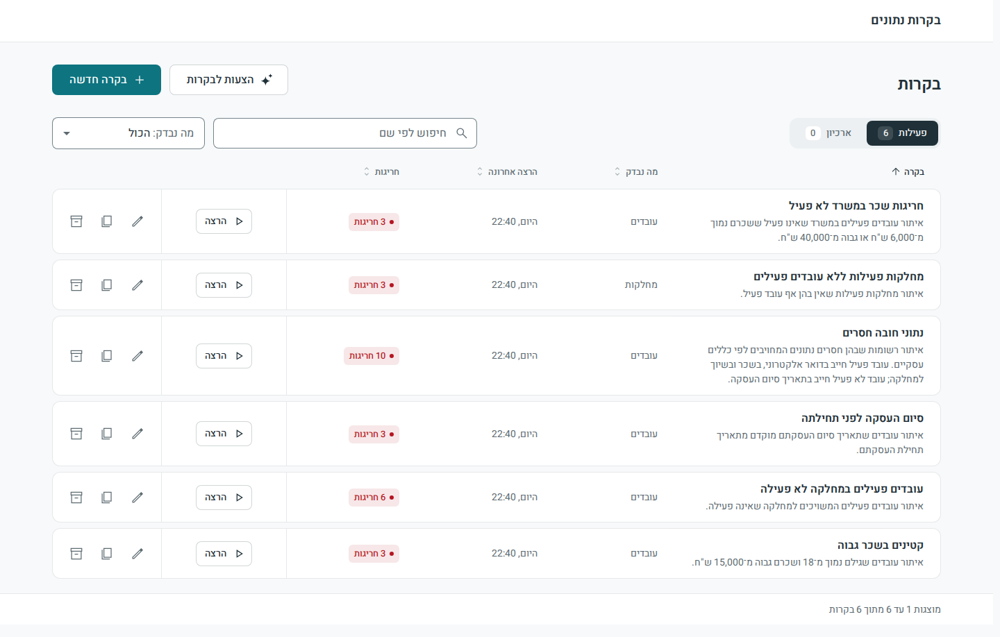

# בקרות נתונים – מסמכי ההגשה

מבחן Fullstack: מערכת בקרות נתונים דינאמית (PYTHON, &lrm;.NET, Angular, SQL Server).

בתיקייה הזאת נמצאים מסמכי ההגשה בעברית, מסמך לכל תוצר שהמטלה מבקשת. המסמכים המפורטים נמצאים בתיקייה [`docs/`&lrm;](../docs), והם כתובים באנגלית.

## מה המערכת

מערכת גנרית להגדרת בקרות איכות נתונים, להרצתן ולניתוח החריגות. משתמש עסקי מגדיר בקרה בממשק בעברית, מתוך מונחים עסקיים בלבד: בלי SQL, בלי שמות טבלאות ובלי שמות שדות. המערכת מתרגמת את ההגדרה לשאילתה אחת עם פרמטרים, מריצה אותה בהרשאת קריאה בלבד, ומציגה את הרשומות החריגות ואת הסיבה לכל חריגה.

בקרה חדשה היא נתון ולא קוד: אין שאילתה קבועה לבקרה ואין פיתוח ייעודי לבקרה. הוספת שדה, ישות או קשר היא עריכה של קובץ אחד, מילון המונחים העסקי.

## תוצרים להגשה

<table dir="rtl">
<thead>
<tr dir="rtl"><th dir="rtl" align="right"></th><th dir="rtl" align="right">&rlm;התוצר, בלשון המטלה</th><th dir="rtl" align="right">&rlm;היכן</th></tr>
</thead>
<tbody>
<tr dir="rtl"><td dir="rtl" align="right">&rlm;1</td><td dir="rtl" align="right">&rlm;קוד מקור מלא של צד הלקוח וצד השרת</td><td dir="rtl" align="right">&rlm;צד הלקוח: <a href="../web"><code>web/</code></a>, ב־Angular צד השרת, ה־API: <a href="../api"><code>api/</code></a>, ב־&lrm;.NET 10 צד השרת, מנוע הבקרות: <a href="../engine"><code>engine/</code></a>, ב־Python</td></tr>
<tr dir="rtl"><td dir="rtl" align="right">&rlm;2</td><td dir="rtl" align="right">&rlm;סקריפטים להקמת בסיס הנתונים וטעינת נתוני דוגמה</td><td dir="rtl" align="right">&rlm;התיקייה <a href="../sql"><code>sql/</code></a>. מה כל סקריפט יוצר ואיך מריצים אותו: <a href="install.he.md">install.he.md</a>, פרק ג</td></tr>
<tr dir="rtl"><td dir="rtl" align="right">&rlm;3</td><td dir="rtl" align="right">&rlm;הוראות התקנה והרצה</td><td dir="rtl" align="right">&rlm;<a href="install.he.md">install.he.md</a></td></tr>
<tr dir="rtl"><td dir="rtl" align="right">&rlm;4</td><td dir="rtl" align="right">&rlm;מסמך קצר המתאר את הארכיטקטורה ואת מנגנון הבקרות</td><td dir="rtl" align="right">&rlm;<a href="summarize-architecture.he.md">summarize-architecture.he.md</a></td></tr>
<tr dir="rtl"><td dir="rtl" align="right">&rlm;5</td><td dir="rtl" align="right">&rlm;דוגמאות לבקרות שניתן להגדיר ולהריץ</td><td dir="rtl" align="right">&rlm;<a href="examples.he.md">examples.he.md</a></td></tr>
<tr dir="rtl"><td dir="rtl" align="right">&rlm;6</td><td dir="rtl" align="right">&rlm;פירוט קצר של הנחות העבודה, המגבלות והרחבות אפשריות</td><td dir="rtl" align="right">&rlm;<a href="assumptions-limitations-extensions.he.md">assumptions-limitations-extensions.he.md</a></td></tr>
<tr dir="rtl"><td dir="rtl" align="right">&rlm;7</td><td dir="rtl" align="right">&rlm;פירוט כלי ה־AI שבהם נעשה שימוש ומטרת השימוש בכל אחד מהם</td><td dir="rtl" align="right">&rlm;<a href="ai-usage.he.md">ai-usage.he.md</a></td></tr>
<tr dir="rtl"><td dir="rtl" align="right">&rlm;+</td><td dir="rtl" align="right">&rlm;המשימה המתקדמת (רשות): תכנון יכולת שבה AI מציע בקרות</td><td dir="rtl" align="right">&rlm;<a href="ai-suggestions.he.md">ai-suggestions.he.md</a></td></tr>
</tbody>
</table>

## הרצה מהירה

נדרש Docker בלבד. מתוך תיקיית המאגר:

<table dir="rtl">
<thead>
<tr dir="rtl"><th dir="rtl" align="right">&rlm;מערכת הפעלה</th><th dir="rtl" align="right">&rlm;פקודה</th></tr>
</thead>
<tbody>
<tr dir="rtl"><td dir="rtl" align="right">&rlm;Windows</td><td dir="rtl" align="right">&rlm;<code>start.cmd</code></td></tr>
<tr dir="rtl"><td dir="rtl" align="right">&rlm;Linux, macOS, WSL</td><td dir="rtl" align="right">&rlm;<code>scripts/start.sh</code></td></tr>
</tbody>
</table>

בסיום המערכת זמינה בדפדפן בכתובת http://localhost:5000, וברשימה שש בקרות לדוגמה מוכנות להרצה. ההרצה הראשונה אורכת כמה דקות. הפירוט המלא, כולל התקנה בלי Docker, נמצא במסמך [install.he.md](install.he.md).

## המסמכים באנגלית

למי שרוצה את הגרסה המפורטת:

<table dir="rtl">
<thead>
<tr dir="rtl"><th dir="rtl" align="right">&rlm;נושא</th><th dir="rtl" align="right">&rlm;מסמך</th></tr>
</thead>
<tbody>
<tr dir="rtl"><td dir="rtl" align="right">&rlm;התקנה, הרצה, בדיקות ותפעול</td><td dir="rtl" align="right">&rlm;<a href="../README.md">README.md</a></td></tr>
<tr dir="rtl"><td dir="rtl" align="right">&rlm;הארכיטקטורה המלאה</td><td dir="rtl" align="right">&rlm;<a href="../docs/architecture.md">docs/architecture.md</a></td></tr>
<tr dir="rtl"><td dir="rtl" align="right">&rlm;הארכיטקטורה בקצרה</td><td dir="rtl" align="right">&rlm;<a href="../docs/summarize-architecture.md">docs/summarize-architecture.md</a></td></tr>
<tr dir="rtl"><td dir="rtl" align="right">&rlm;מבנה הגדרת הבקרה</td><td dir="rtl" align="right">&rlm;<a href="../docs/control-definition.md">docs/control-definition.md</a></td></tr>
<tr dir="rtl"><td dir="rtl" align="right">&rlm;מילון המונחים ואיך מרחיבים אותו</td><td dir="rtl" align="right">&rlm;<a href="../docs/glossary.md">docs/glossary.md</a></td></tr>
<tr dir="rtl"><td dir="rtl" align="right">&rlm;שש הבקרות לדוגמה, עם כל הרשומות שהן מוצאות</td><td dir="rtl" align="right">&rlm;<a href="../docs/examples.md">docs/examples.md</a></td></tr>
<tr dir="rtl"><td dir="rtl" align="right">&rlm;הנחות, מגבלות והרחבות</td><td dir="rtl" align="right">&rlm;<a href="../docs/assumptions-limitations-extensions.md">docs/assumptions-limitations-extensions.md</a></td></tr>
<tr dir="rtl"><td dir="rtl" align="right">&rlm;כלי ה־AI</td><td dir="rtl" align="right">&rlm;<a href="../docs/ai-usage.md">docs/ai-usage.md</a></td></tr>
</tbody>
</table>

## איך העבודה נעשתה

הפיתוח נעשה בעזרת Claude Code ובעזרת הצ'אט של claude.ai, כמפורט ב־[ai-usage.he.md](ai-usage.he.md). במערכת עצמה אינו פועל שום רכיב AI.

העבודה חולקה לחמש משימות, ולכל אחת תוכנית עבודה, יומן החלטות ותוצאות בדיקה. הן שמורות במאגר, בתיקייה [`dev/`&lrm;](../dev), כדי שאפשר יהיה לראות את התהליך ולא רק את התוצאה.

