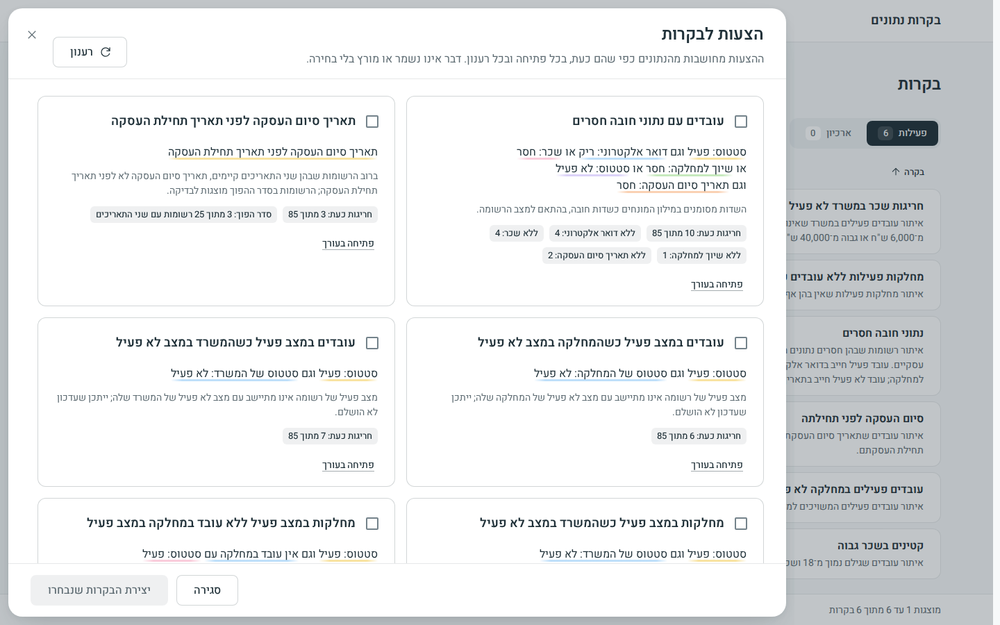
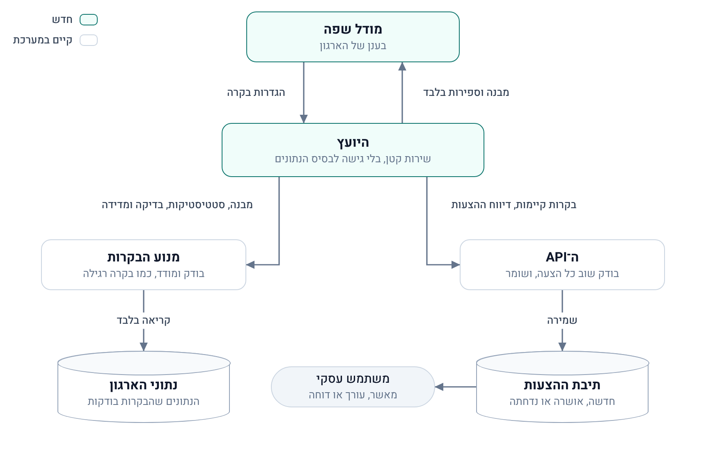
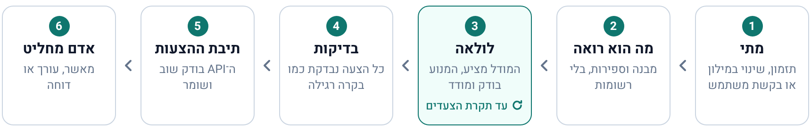
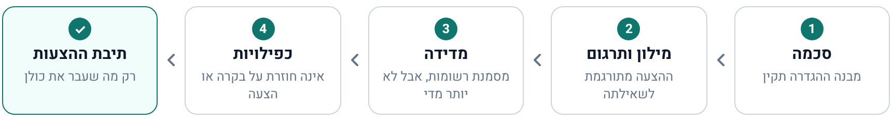

# המשימה המתקדמת: AI שמציע בקרות

**המשימה המתקדמת (רשות).** [לכל התוצרים](README.he.md)

> משימה מתקדמת – רשות: תכנון יכולת שבה ה־AI מנתח את מבנה בסיס הנתונים ומציע באופן יזום בקרות איכות נתונים רלוונטיות.

**סטטוס: מתוכנן, לא נבנה.** המטלה מבקשת תכנון, וזה התכנון. תוכנית העבודה המלאה למימוש נמצאת בתיקיית המשימה: [dev/active/dc-ai-suggestions/plan.md](../dev/active/dc-ai-suggestions/plan.md).

## התשובה במשפט אחד

שירות קטן ונפרד, "היועץ", מפעיל מודל שפה שלומד את מבנה הנתונים ואת הסטטיסטיקות שלהם, ומציע בקרות באותו פורמט שבו משתמש מגדיר בקרה. המערכת בודקת כל הצעה באותם כלים שבודקים בקרה רגילה. אדם מאשר, ושום דבר אינו מופעל לבד.

## מה כבר קיים היום

במערכת יש כבר הצעות לבקרות, בלי מודל שפה: הכפתור "הצעות לבקרות". המנוע גוזר אותן ממילון המונחים ומספירות על הנתונים: שדות חובה חסרים, תאריכים בסדר הפוך, רשומה פעילה תחת רשומה לא פעילה. על נתוני הדוגמה הוא מוצא ארבע מתוך שש הבקרות לדוגמה.

מה שהוא אינו יכול למצוא הוא הדוגמה הראשונה במטלה, "גיל נמוך מ־18 ושכר גבוה מ־15,000". המספרים 18 ו־15,000 הם ידע עסקי, ולא משהו שנגזר ממבנה הנתונים. זה המקום שבו מודל שפה מוסיף ערך.

## הרכיבים

היועץ הוא שירות רביעי, והיחיד שמדבר עם מודל שפה. למה שירות נפרד ולא שלב בתוך המנוע:

- **המנוע נשאר דטרמיניסטי.** אותה הגדרה על אותם נתונים נותנת תמיד אותה תוצאה, ואין בו מפתח של מודל.
- **התהליך שקורא את נתוני הארגון אינו יוצא לרשת.** רק היועץ מתחבר למודל, והוא עצמו אינו מחובר לבסיס הנתונים.
- **תקלה במודל אינה פוגעת בהרצת בקרות.** אם המודל אינו זמין, ההצעות הקיימות ממשיכות לעבוד.

## איך היועץ עובד

1. **מתי הוא רץ.** פעם ביום, בכל שינוי במילון המונחים, או כשמשתמש לוחץ "הרץ עכשיו". זה ה"באופן יזום".
2. **מה הוא רואה.** ישות עסקית אחת בכל פעם: השדות שלה, הקשרים שלה והסטטיסטיקות שלה (כמה רשומות יש, כמה חסרות בכל שדה, איך הערכים מתפזרים בטווחים). בנוסף הוא רואה את הבקרות שכבר קיימות, כדי לא להציע כפילויות.
3. **איך הוא חושב.** המודל עובד בלולאה עם שישה כלים. הוא מעלה השערה, שואל כמה רשומות הכלל היה מסמן, מקבל מספר בלבד, ואז מגיש הצעה.
4. **איך בודקים אותו.** כל הצעה עוברת את אותה בדיקה ואותו תרגום לשאילתה שבקרה של משתמש עוברת. הפירוט בפרק הבא.
5. **לאן ההצעות מגיעות.** ה־API בודק כל הצעה פעם נוספת בעצמו, ושומר אותה בתיבת ההצעות. המשפט והראיה שמוצגים למשתמש הם של המנוע, ולא ניסוח של המודל.
6. **מי מחליט.** משתמש עסקי מאשר, עורך או דוחה. הצעה שאושרה הופכת לבקרה רגילה.

## הבדיקות שכל הצעה עוברת

<table dir="rtl">
<thead>
<tr dir="rtl"><th dir="rtl" align="right">&rlm;הבדיקה</th><th dir="rtl" align="right">&rlm;מה קורה להצעה שנכשלת</th></tr>
</thead>
<tbody>
<tr dir="rtl"><td dir="rtl" align="right">&rlm;סכמת ה־JSON של הגדרת בקרה</td><td dir="rtl" align="right">&rlm;השגיאות חוזרות למודל</td></tr>
<tr dir="rtl"><td dir="rtl" align="right">&rlm;הבדיקה מול מילון המונחים והתרגום לשאילתה, במנוע</td><td dir="rtl" align="right">&rlm;השגיאות חוזרות למודל, והוא רשאי לתקן עד פעמיים. אחר כך ההצעה נדחית</td></tr>
<tr dir="rtl"><td dir="rtl" align="right">&rlm;מדידה: כמה רשומות ההצעה מסמנת היום</td><td dir="rtl" align="right">&rlm;נזרקת אם אינה מסמנת אף רשומה, או אם היא מסמנת יותר מחמישית מהרשומות</td></tr>
<tr dir="rtl"><td dir="rtl" align="right">&rlm;כפילות מול בקרות קיימות והצעות קודמות, גם כאלה שנדחו</td><td dir="rtl" align="right">&rlm;נזרקת</td></tr>
</tbody>
</table>

התוצאה: הצעה שמגיעה למשתמש היא תמיד בקרה תקינה שניתן להריץ, והיא מסמנת רשומות אמיתיות היום.

## העקרונות שמאחורי התכנון

- **המודל אף פעם אינו כותב SQL.** הוא מחזיר הגדרת בקרה ב־JSON, והמערכת מתרגמת אותה לשאילתה כמו כל בקרה. הפלט שלו נחשב לא מהימן עד שנבדק.
- **אין לו גישה לבסיס הנתונים.** הכלים שלו הם קריאות HTTP למנוע ול־API בלבד, ואין לו משתמש בבסיס הנתונים.
- **רשומות אינן נשלחות למודל.** רק מבנה וספירות. גם סטטיסטיקה יכולה לחשוף פרט: שכר מקסימלי הוא שכרו של עובד אחד. לכן אין מינימום, מקסימום או ממוצע, אלא ספירות בטווחים קבועים מראש.
- **יש תקרה לכל דבר.** מספר הצעדים, הטוקנים, הזמן והעלות מוגבלים לכל הרצה ולכל יום.
- **הכול מתועד.** לכל הרצה נשמרים גרסת ההנחיה (prompt), הכלים שהופעלו ומה קרה לכל הצעה.
- **המערכת עובדת גם בלי מודל.** ההצעות שקיימות היום נשארות כבסיס וכגיבוי.
- **המודל רץ בענן של הארגון**, לדוגמה Vertex AI ב־GCP. הכתובת והמפתח מגיעים מהגדרות הסביבה, והשירות כולו הוא רכיב אופציונלי.

## בסיס נתונים גדול

ההנחיה למודל גדלה עם הישות הרחבה ביותר, ולא עם מספר הטבלאות או מספר הרשומות: בכל שיחה נשלחת ישות אחת עם שכנותיה. קטלוג גדול מכוסה לאורך כמה הרצות. הסטטיסטיקות מחושבות מראש, ובטבלאות גדולות על מדגם.

## איך נדע שזה עובד

על נתוני הדוגמה היועץ חייב לגלות מחדש את הכללים שנשתלו בהם, כולל הדוגמה הראשונה במטלה. הבדיקות רצות על תשובות מוקלטות של מודל, ולכן אינן דורשות מפתח ואינן עולות כסף.

## איפה הפרטים

תוכנית העבודה, [plan.md](../dev/active/dc-ai-suggestions/plan.md), כתובה באנגלית ובאותו מבנה כמו חמש המשימות שבוצעו. מה שיש בה:

<table dir="rtl">
<thead>
<tr dir="rtl"><th dir="rtl" align="right">&rlm;פרק בתוכנית</th><th dir="rtl" align="right">&rlm;מה יש בו</th></tr>
</thead>
<tbody>
<tr dir="rtl"><td dir="rtl" align="right">&rlm;Decisions</td><td dir="rtl" align="right">&rlm;23 החלטות, עם הנימוק לכל אחת והחלופה שנדחתה</td></tr>
<tr dir="rtl"><td dir="rtl" align="right">&rlm;Contract changes</td><td dir="rtl" align="right">&rlm;השינויים בשני ממשקי ה־HTTP ובקודי השגיאה</td></tr>
<tr dir="rtl"><td dir="rtl" align="right">&rlm;Phases</td><td dir="rtl" align="right">&rlm;שמונה שלבים, מהחוזים ועד רכיב אופציונלי ב־Docker, ושער בדיקה בסוף</td></tr>
<tr dir="rtl"><td dir="rtl" align="right">&rlm;Design B, C, D</td><td dir="rtl" align="right">&rlm;הכלים של המודל, הלולאה וההנחיה</td></tr>
<tr dir="rtl"><td dir="rtl" align="right">&rlm;Design E</td><td dir="rtl" align="right">&rlm;הכלל שקובע אילו מספרים מותר לשלוח למודל</td></tr>
<tr dir="rtl"><td dir="rtl" align="right">&rlm;Design J</td><td dir="rtl" align="right">&rlm;מודל האבטחה: מה עלול להשתבש, ומה עוצר זאת</td></tr>
<tr dir="rtl"><td dir="rtl" align="right">&rlm;Risks</td><td dir="rtl" align="right">&rlm;הסיכונים הידועים, ומה עושים אם הם מתממשים</td></tr>
</tbody>
</table>

ההצעות שקיימות היום, בקוד: [`engine/app/suggestions/`&lrm;](../engine/app/suggestions).

