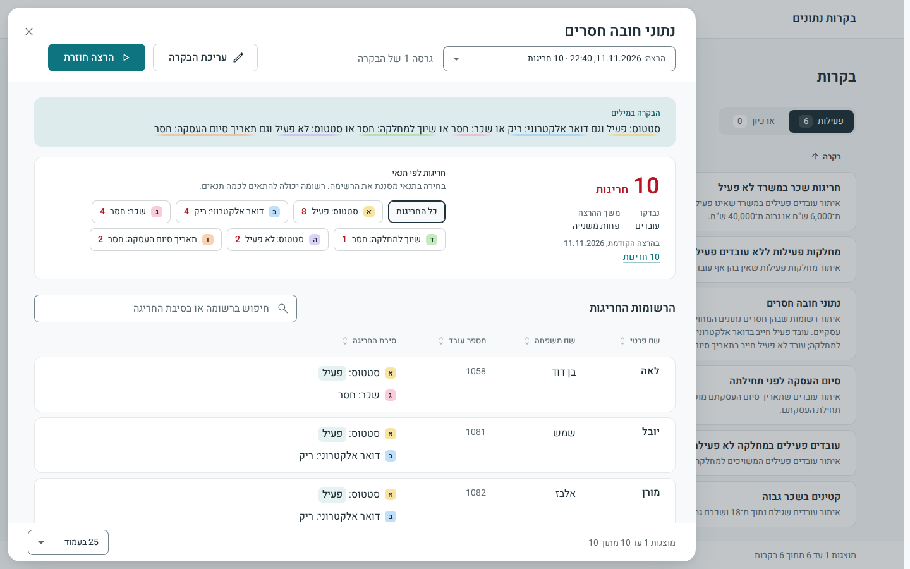
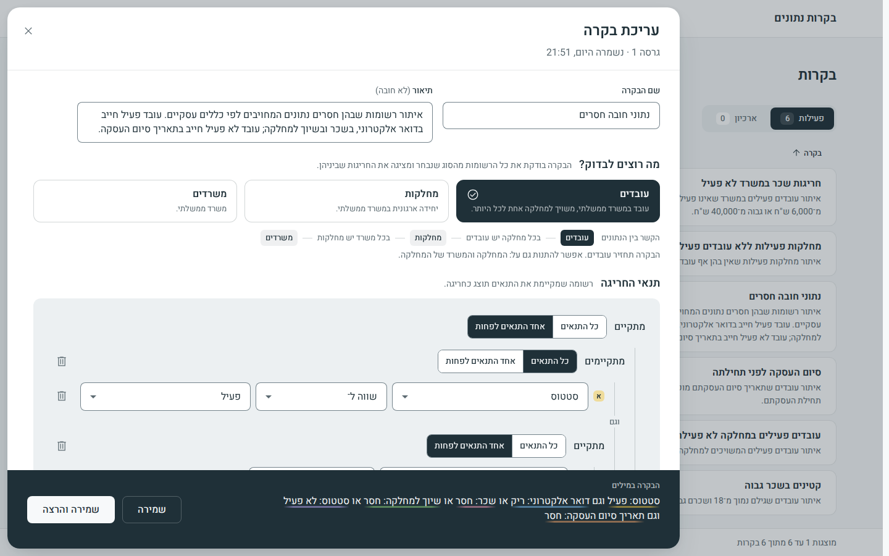

# דוגמאות לבקרות

**תוצר 5 מתוך 7:** דוגמאות לבקרות שניתן להגדיר ולהריץ. [לכל התוצרים](README.he.md)

שש בקרות נטענות למערכת בהרצה הראשונה, מוכנות להרצה בלחיצה. בקרות 1 עד 4 הן ארבע הדוגמאות שבמטלה. בקרות 5 ו־6 נוספו כדי להדגים כלל על מחלקות, וכלל שעובר דרך שני קשרים. אף אחת מהן אינה קוד: כל בקרה היא קובץ JSON בתיקייה [`contracts/examples/`&lrm;](../contracts/examples).

<table dir="rtl">
<thead>
<tr dir="rtl"><th dir="rtl" align="right"></th><th dir="rtl" align="right">&rlm;הבקרה</th><th dir="rtl" align="right">&rlm;הכלל, כפי שהמערכת מנסחת אותו</th><th dir="rtl" align="right">&rlm;חריגות בנתוני הדוגמה</th></tr>
</thead>
<tbody>
<tr dir="rtl"><td dir="rtl" align="right">&rlm;1</td><td dir="rtl" align="right">&rlm;קטינים בשכר גבוה</td><td dir="rtl" align="right">&rlm;גיל מתחת ל־18 וגם שכר מעל 15,000 ₪</td><td dir="rtl" align="right">&rlm;3</td></tr>
<tr dir="rtl"><td dir="rtl" align="right">&rlm;2</td><td dir="rtl" align="right">&rlm;סיום העסקה לפני תחילתה</td><td dir="rtl" align="right">&rlm;תאריך סיום העסקה לפני תאריך תחילת העסקה</td><td dir="rtl" align="right">&rlm;3</td></tr>
<tr dir="rtl"><td dir="rtl" align="right">&rlm;3</td><td dir="rtl" align="right">&rlm;עובדים פעילים במחלקה לא פעילה</td><td dir="rtl" align="right">&rlm;סטטוס: פעיל וגם סטטוס של המחלקה: לא פעיל</td><td dir="rtl" align="right">&rlm;6</td></tr>
<tr dir="rtl"><td dir="rtl" align="right">&rlm;4</td><td dir="rtl" align="right">&rlm;נתוני חובה חסרים</td><td dir="rtl" align="right">&rlm;(סטטוס: פעיל וגם (דואר אלקטרוני: ריק או שכר: חסר או שיוך למחלקה: חסר)) או (סטטוס: לא פעיל וגם תאריך סיום העסקה: חסר)</td><td dir="rtl" align="right">&rlm;10</td></tr>
<tr dir="rtl"><td dir="rtl" align="right">&rlm;5</td><td dir="rtl" align="right">&rlm;מחלקות פעילות ללא עובדים פעילים</td><td dir="rtl" align="right">&rlm;סטטוס: פעיל וגם אין עובד במחלקה עם (סטטוס: פעיל)</td><td dir="rtl" align="right">&rlm;3</td></tr>
<tr dir="rtl"><td dir="rtl" align="right">&rlm;6</td><td dir="rtl" align="right">&rlm;חריגות שכר במשרד לא פעיל</td><td dir="rtl" align="right">&rlm;סטטוס: פעיל וגם סטטוס של המשרד: לא פעיל וגם (שכר מתחת ל־6,000 ₪ או שכר מעל 40,000 ₪)</td><td dir="rtl" align="right">&rlm;3</td></tr>
</tbody>
</table>

ליד כל רשומה חריגה מוצגת הסיבה, עם הערכים של הרשומה עצמה. לדוגמה, בבקרה הראשונה: "גיל: 16 (מתחת ל־18); שכר: 16,500 ₪ (מעל 15,000 ₪)".

## הרצה

ברשימת הבקרות לוחצים על "הרצה" בשורה של הבקרה. לחיצה על השורה פותחת את התוצאות: מספר החריגות, והרשומות החריגות עם הסיבה לכל אחת.

## הגדרת בקרה חדשה

לוחצים על "בקרה חדשה", בוחרים מה בודקים (עובדים, מחלקות או משרדים), ומוסיפים תנאים: שדה, אופרטור וערך. המשפט "הבקרה במילים" מתעדכן בכל שינוי.

ההגדרה המלאה של כל דוגמה ב־JSON, וכל הרשומות שהיא מוצאת, נמצאות במסמך באנגלית: [docs/examples.md](../docs/examples.md).

