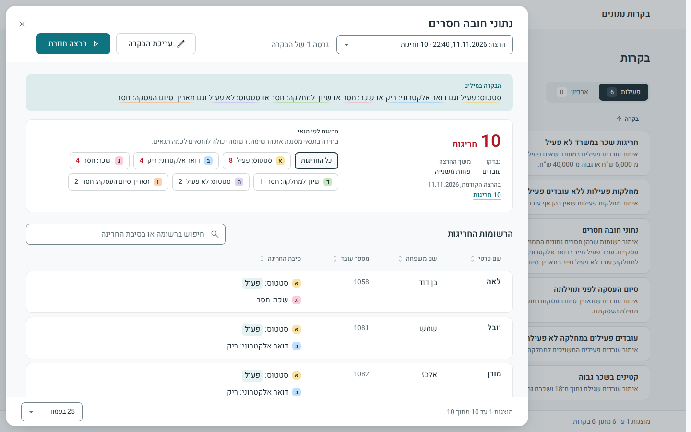
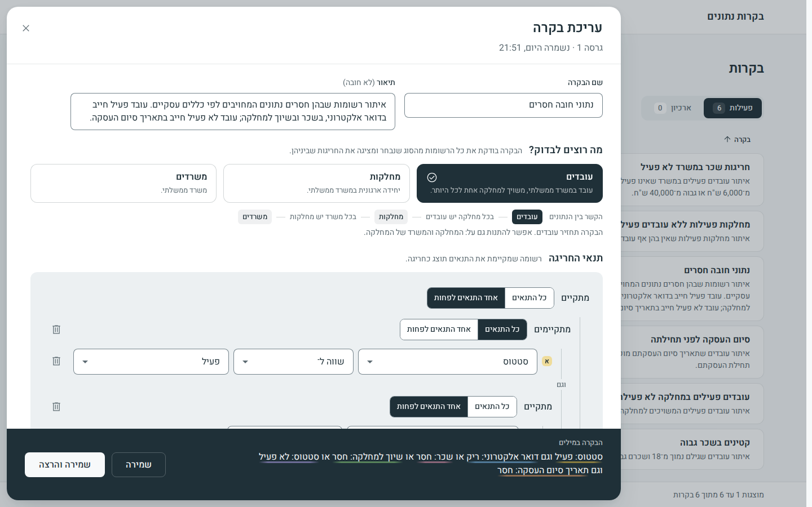

<div dir="rtl">

# דוגמאות לבקרות

**תוצר 5 מתוך 7:** דוגמאות לבקרות שניתן להגדיר ולהריץ. [לכל התוצרים](README.he.md)

שש בקרות מוגדרות במערכת ונטענות בהרצה הראשונה, מוכנות להרצה בלחיצה: ארבע הדוגמאות שבמטלה, ועוד שתיים שמדגימות מה שהדוגמאות במטלה אינן מדגימות. אף אחת מהן אינה קוד. כל אחת היא קובץ JSON בתיקייה [`contracts/examples/`‎](../contracts/examples), באותו מבנה שהממשק שומר כשמשתמש מגדיר בקרה.

## שש הבקרות

| | שם הבקרה במערכת | מה היא מדגימה | חריגות בנתוני הדוגמה |
|---|---|---|---|
| 1 | קטינים בשכר גבוה | שני תנאים שמחוברים ב"וגם", ושדה מחושב: גיל, לפי תאריך ההרצה | 3 |
| 2 | סיום העסקה לפני תחילתה | השוואה בין שני שדות של אותה רשומה | 3 |
| 3 | עובדים פעילים במחלקה לא פעילה | שדה של ישות קשורה: המחלקה של העובד | 6 |
| 4 | נתוני חובה חסרים | קבוצות מקוננות של "וגם" ו"או", והאופרטורים שמאתרים נתון חסר | 10 |
| 5 | מחלקות פעילות ללא עובדים פעילים | ישות נבדקת אחרת (מחלקות), ותנאי על רשומות קשורות: "אין עובד ש…" | 3 |
| 6 | חריגות שכר במשרד לא פעיל | מסלול של שני קשרים: מהעובד למחלקה, ומהמחלקה למשרד | 3 |

בקרות 1 עד 4 הן ארבע הדוגמאות שבמטלה, לפי הסדר שלהן שם. בקרות 5 ו־6 נוספו.

## הכלל והסיבה של כל בקרה

לכל בקרה מוצגים כאן שני טקסטים שהמנוע מנסח בעצמו, מתוך מילון המונחים: **הכלל במילים**, שהמשתמש רואה בזמן שהוא בונה את הבקרה, ו**סיבת החריגה**, שמוצגת בתוצאות ליד כל רשומה, עם הערכים של הרשומה עצמה. בנתוני הדוגמה נשתלו גם **מקרי גבול**: רשומות שכמעט מתאימות לכלל, ושבקרה נכונה אינה מוצאת.

### 1. קטינים בשכר גבוה

המטלה: "איתור עובדים שגילם נמוך מ־18 ושכרם גבוה מ־15,000 ש"ח".

- **הכלל במילים:** גיל מתחת ל־18 וגם שכר מעל 15,000 ₪
- **סיבה לדוגמה** (אריאל מור, מספר עובד 1051): גיל: 16 (מתחת ל־18); שכר: 16,500 ₪ (מעל 15,000 ₪)
- **מקרי גבול שאינם חריגים:** עובד שמלאו לו 18 בתאריך ההרצה, וקטין ששכרו 15,000 ₪ בדיוק.

### 2. סיום העסקה לפני תחילתה

המטלה: "איתור עובדים שתאריך סיום העסקתם מוקדם מתאריך תחילת העסקתם".

- **הכלל במילים:** תאריך סיום העסקה לפני תאריך תחילת העסקה
- **סיבה לדוגמה** (אסף גרינברג, מספר עובד 1061): תאריך סיום העסקה: 01.06.2012 (לפני תאריך תחילת העסקה: 01.06.2015)
- **מקרי גבול שאינם חריגים:** עובד שסיים ביום שבו התחיל, ועובד שאין לו תאריך סיום.

### 3. עובדים פעילים במחלקה לא פעילה

המטלה: "איתור עובדים פעילים המשויכים למחלקה שאינה פעילה".

- **הכלל במילים:** סטטוס: פעיל וגם סטטוס של המחלקה: לא פעיל
- **סיבה לדוגמה** (רנא חורי, מספר עובד 1071): סטטוס: פעיל; סטטוס של המחלקה: לא פעיל
- **מקרי גבול שאינם חריגים:** עובד לא פעיל במחלקה לא פעילה, ועובד שאינו משויך למחלקה.

### 4. נתוני חובה חסרים

המטלה: "איתור רשומות שבהן חסרים נתונים המחויבים לפי כללים עסקיים". הכללים העסקיים שנקבעו לדוגמה: עובד פעיל חייב בדואר אלקטרוני, בשכר ובשיוך למחלקה, ועובד לא פעיל חייב בתאריך סיום העסקה.

- **הכלל במילים:** (סטטוס: פעיל וגם (דואר אלקטרוני: ריק או שכר: חסר או שיוך למחלקה: חסר)) או (סטטוס: לא פעיל וגם תאריך סיום העסקה: חסר)
- **סיבה לדוגמה** (אחינועם לביא, מספר עובד 1086): סטטוס: פעיל; דואר אלקטרוני: ריק; שכר: חסר
- **מקרי גבול שאינם חריגים:** עובד לא פעיל שאין לו שכר או שהדואר האלקטרוני שלו ריק. החובות האלה חלות על עובדים פעילים בלבד.

### 5. מחלקות פעילות ללא עובדים פעילים

נוספה כדי להדגים כלל על רשומות קשורות. כאן נבדקות מחלקות, ולא עובדים.

- **הכלל במילים:** סטטוס: פעיל וגם אין עובד במחלקה עם (סטטוס: פעיל)
- **סיבה לדוגמה** (מחלקת ארכיון רפואי, מספר מחלקה 104): סטטוס: פעיל; אין עובד במחלקה עם סטטוס: פעיל
- **מקרי גבול שאינם חריגים:** מחלקה שיש בה עובד פעיל אחד, ומחלקה לא פעילה.

### 6. חריגות שכר במשרד לא פעיל

נוספה כדי להדגים מסלול של שני קשרים: עובדים פעילים במשרד שאינו פעיל, ששכרם נמוך מ־6,000 ש"ח או גבוה מ־40,000 ש"ח.

- **הכלל במילים:** סטטוס: פעיל וגם סטטוס של המשרד: לא פעיל וגם (שכר מתחת ל־6,000 ₪ או שכר מעל 40,000 ₪)
- **סיבה לדוגמה** (עוז ירושלמי, מספר עובד 1111): סטטוס: פעיל; סטטוס של המשרד: לא פעיל; שכר: 4,500 ₪ (מתחת ל־6,000 ₪)
- **מקרי גבול שאינם חריגים:** שכר של 6,000 ₪ בדיוק או של 40,000 ₪ בדיוק, ושכר חריג במשרד פעיל.

בממשק "הבקרה במילים" מוצגת בלי סוגריים, עם קו צבעוני מתחת לכל תנאי. המבנה המדויק של הקבוצות נראה בבונה התנאים.

## איך מריצים בקרה וקוראים את התוצאות

ברשימת הבקרות לוחצים על "הרצה" בשורה של הבקרה. בשורה מופיע מספר החריגות, ולחיצה על השורה פותחת את התוצאות:

- **הבקרה במילים**, ומספר החריגות.
- **חריגות לפי תנאי:** כמה רשומות נמצאו בגלל כל תנאי. לחיצה על תנאי מסננת את הרשימה.
- **הרשומות החריגות:** לכל רשומה פרטי הזיהוי שלה וסיבת החריגה. אפשר לחפש, למיין לפי כל עמודה ולדפדף.



## איך מגדירים בקרה חדשה

1. ברשימת הבקרות לוחצים על "בקרה חדשה".
2. נותנים לבקרה שם, ובוחרים "מה רוצים לבדוק?": עובדים, מחלקות או משרדים.
3. תחת "תנאי החריגה" מוסיפים תנאים. בכל תנאי בוחרים שדה, אופרטור שמתאים לסוג השדה, וערך. אפשר לבחור גם שדות של ישות קשורה, למשל הסטטוס של המחלקה של העובד.
4. הכפתור "מתקדם" מוסיף קבוצות של תנאים, ותנאים על רשומות קשורות ("אין עובד ש…").
5. המשפט "הבקרה במילים" מתעדכן בכל שינוי. תנאי שאינו תקין מסומן, עם הסבר מה צריך לתקן.
6. לוחצים על "שמירה", או על "שמירה והרצה".



אפשר גם להתחיל מהצעה. הכפתור "הצעות לבקרות" מציג בקרות שהמערכת גוזרת בעצמה מהנתונים, בלי AI, ובהן ארבע משש הבקרות שלמעלה (2 עד 5).

## איך בודקים שהדוגמאות נכונות

לכל דוגמה שמורה, בקובץ שלה, רשימת הרשומות שהיא חייבת למצוא. הפקודה הבאה מריצה את שש הדוגמאות דרך המערכת הרצה, ומשווה את התוצאות לרשימות:

</div>

```sh
python3 scripts/examples.py verify
```

<div dir="rtl">

הדוגמאות מוצאות את אותן רשומות בכל תאריך הרצה מ־1.11.2026 עד 31.12.2027. אחרי התאריך הזה הגילים שבנתוני הדוגמה משתנים, והבקרה הראשונה מוצאת פחות רשומות.

ההגדרה המלאה של כל דוגמה ב־JSON, וכל הרשומות שהיא מוצאת עם הסיבות שלהן, נמצאות במסמך באנגלית: [docs/examples.md](../docs/examples.md).

</div>
