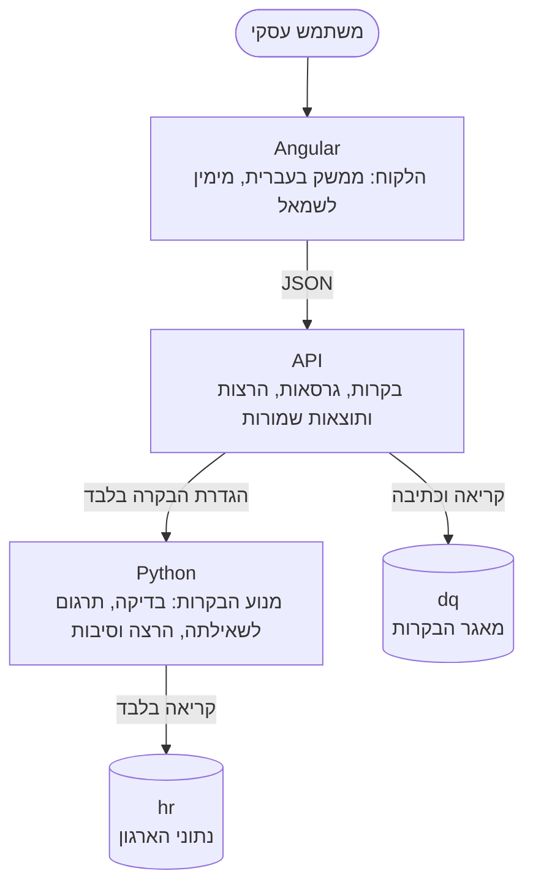
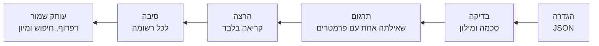
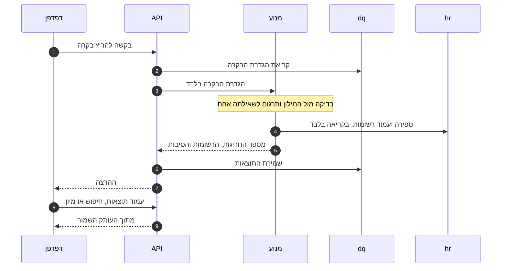

<div dir="rtl">

# הארכיטקטורה ומנגנון הבקרות

**תוצר 4 מתוך 7:** מסמך קצר המתאר את הארכיטקטורה ואת מנגנון הבקרות. [לכל התוצרים](README.he.md)

המסמך המלא, באנגלית: [docs/architecture.md](../docs/architecture.md).

## מה המערכת עושה

משתמש עסקי מכיר את משמעות הנתונים, אבל לא את SQL ולא את הטבלאות. הוא בונה **בקרה**: כלל בעל שם שמאתר רשומות בעייתיות, למשל "עובדים שגילם נמוך מ־18 ושכרם גבוה מ־15,000". הוא בונה אותה בממשק בעברית, מתוך מונחים עסקיים בלבד. המערכת מתרגמת את הכלל לשאילתה אחת, מריצה אותה, ומציגה את **החריגות**: הרשומות שנמצאו, וליד כל אחת הסיבה.

בקרה חדשה היא נתון ולא קוד. לא נכתב עבורה קוד, ולא נשמרת עבורה שאילתה.

## הרכיבים



| רכיב | אחראי על | אף פעם לא |
|---|---|---|
| הלקוח, Angular | רשימת הבקרות, בניית הכלל והצגת התוצאות. כל רשימת בחירה נבנית ממילון המונחים | מחזיק שם של טבלה או עמודה, או שולח SQL |
| ה־API, ‎.NET 10 | חיי הבקרה: יצירה, עריכה, גרסאות וארכיון. ההרצות והתוצאות השמורות | בונה או מריץ SQL דינמי, או קורא את נתוני הארגון |
| המנוע, Python | מילון המונחים, בדיקת המשמעות, התרגום לשאילתה, ההרצה, הסיבות וההצעות | כותב לבסיס נתונים, או מקבל מבחוץ שם של טבלה או עמודה |
| בסיס הנתונים, SQL Server | שתי סכמות, `hr` ו־`dq`, ושני משתמשים שכל אחד מהם יכול לעשות דבר אחד | |

שלושת השירותים חולקים דבר אחד בלבד: התיקייה [`contracts/`‎](../contracts), ובה מילון המונחים, סכמת הגדרת הבקרה, שש בקרות לדוגמה ותיאור שני ממשקי ה־HTTP. אף שירות אינו משתמש בקוד של שירות אחר.

**ההפרדה שהמטלה מבקשת**, בין הגדרת הבקרה לבין מימוש השאילתה, היא כאן גבול בין שירותים. ה־API מחזיק את ההגדרות ויכול לכתוב, אבל אינו יכול להגיע לנתוני הארגון. המנוע בונה ומריץ את ה־SQL, והמשתמש שלו בבסיס הנתונים יכול רק לקרוא. באג במנוע אינו יכול לשנות נתונים, ובאג ב־API אינו יכול להריץ שאילתה על נתוני הארגון. טקסט SQL אינו עובר בין השירותים באף כיוון.

## מנגנון הבקרות



### 1. ההגדרה היא נתון

בקרה היא מסמך JSON: הישות שנבדקת, ועץ של קבוצות ("וגם", "או") ותנאים. היא מזכירה רק מפתחות ממילון המונחים. זו הדוגמה הראשונה במטלה:

</div>

```json
{ "schemaVersion": 1, "rootEntity": "employee",
  "where": { "type": "group", "op": "and", "children": [
    { "type": "condition", "id": "c1", "left": { "field": "age" },    "operator": "lt", "value": 18 },
    { "type": "condition", "id": "c2", "left": { "field": "salary" }, "operator": "gt", "value": 15000 } ] } }
```

<div dir="rtl">

ה־API שומר אותה כגרסה שאינה משתנה. ה־JSON הוא מקור האמת. ה־SQL נגזר ממנו בזמן ההרצה ואינו נשמר.

### 2. מילון המונחים נותן למפתחות משמעות

הקובץ [`contracts/glossary.json`](../contracts/glossary.json) מחבר כל מונח עסקי לבסיס הנתונים: "עובד" הוא טבלה, "שכר" הוא עמודה מספרית, "גיל" מחושב מתאריך הלידה, ו"המחלקה של העובד" היא קשר בין טבלאות. הוא מחזיק גם את השמות בעברית, את האופרטורים המותרים לכל סוג שדה, ואת תבניות המשפטים והסיבות.

שמות של טבלאות ועמודות מופיעים בקובץ הזה בלבד, ולא בקוד של אף שירות. **הוספת שדה, ישות או קשר היא עריכה של הקובץ הזה.** המנוע בודק אותו מול בסיס הנתונים כשהוא עולה, ומסרב לעלות אם הם אינם מתאימים.

### 3. בדיקה בשלוש שכבות

1. הלקוח מנחה את המשתמש, ואין סומכים עליו.
2. ה־API בודק את מבנה ההגדרה מול סכמת JSON משותפת.
3. המנוע בודק את המשמעות מול המילון: השדה קיים, האופרטור מתאים לסוג השדה, הערך מתאים, הקשרים מתחברים, והמגבלות נשמרות (עומק 4, עד 30 תנאים).

שגיאה חוזרת כקוד עם מיקום מדויק, והממשק מסמן את השורה השגויה.

### 4. שאילתה אחת עם פרמטרים

המנוע בונה את השאילתה עם SQLAlchemy Core, ולא בחיבור מחרוזות. שמות מגיעים רק מהמילון, וערכים הם תמיד פרמטרים. הדוגמה שלמעלה מתורגמת לשאילתה הבאה, שבה `p0` הוא תאריך ההרצה פחות 18 שנים ו־`p1` הוא 15000:

</div>

```sql
SELECT TOP 5000 q.k, q.d0, q.d1, q.d2, q.a0, q.a1,
       CASE WHEN (q.t0 = 1) THEN 1 ELSE 0 END AS m0, CASE WHEN (q.t1 = 1) THEN 1 ELSE 0 END AS m1
FROM (SELECT e0.id AS k, e0.first_name AS d0, e0.last_name AS d1, e0.id AS d2, e0.birth_date AS a0, e0.salary AS a1,
             CASE WHEN (e0.birth_date > :p0) THEN 1 ELSE 0 END AS t0, CASE WHEN (e0.salary > :p1) THEN 1 ELSE 0 END AS t1
      FROM hr.[Employee] AS e0
      WHERE e0.birth_date > :p0 AND e0.salary > :p1) AS q ORDER BY q.k
```

<div dir="rtl">

הרצה שולחת שתי פקודות כאלה, שתיהן בהרשאת קריאה בלבד ועם מגבלת זמן: ספירה מדויקת של החריגות, והעמוד הזה, עד 5,000 רשומות.

- קשר ל"אחד", כמו המחלקה של העובד, הופך ל־JOIN.
- קשר ל"רבים", כמו "מחלקה שאין בה עובד פעיל", הופך ל־EXISTS או ל־NOT EXISTS, כך ששורות אינן מוכפלות.
- תנאי על גיל הופך לטווח על תאריך הלידה, כך שאינדקס יכול לשרת אותו.

### 5. הסיבה חוזרת עם כל רשומה

השאילתה מחזירה דגל לכל תנאי, ואת ערכי הרשומה עצמה. המנוע מנסח מהם את הסיבה בעברית, מתוך תבניות המילון: "גיל: 16 (מתחת ל־18); שכר: 16,500 ₪ (מעל 15,000 ₪)". מאותן תבניות נוצר גם "הבקרה במילים", המשפט שהמשתמש רואה בזמן שהוא בונה את הכלל. המנוע הוא היחיד שמנסח משפטים וסיבות, והלקוח רק מציג אותם.

### 6. הרצה היא עותק שמור

ה־API שומר את מספר החריגות ואת כל הרשומות החריגות עם הסיבות שלהן. דפדוף, חיפוש, סינון ומיון נענים מהעותק הזה. נתוני הארגון נקראים פעם אחת בלבד בכל הרצה.

## מה קורה כשלוחצים "הרצה"



## מה שומר על ה־SQL הדינמי

ארבע שכבות, וכל אחת מהן עומדת בפני עצמה:

1. **שמות מגיעים רק ממילון המונחים.** משתמש אינו יכול להכניס שם של טבלה או עמודה.
2. **ערכים הם תמיד פרמטרים.** שום ערך אינו נכתב לתוך טקסט השאילתה.
3. **המשתמש של המנוע יכול רק לקרוא**, ורק את נתוני הארגון. כל פקודה שהמנוע שולח היא SELECT יחיד.
4. **לכל דבר יש תקרה:** 5,000 רשומות להרצה, 30 שניות לשאילתה, ומגבלות על העומק והגודל של ההגדרה.

שגיאות עוברות בין השירותים כקודים, ואינן כוללות SQL או הודעה פנימית של המערכת.

## ביצועים

על נתוני הדוגמה (85 עובדים) הרצה אורכת כ־10 אלפיות שנייה. בבדיקת עומס על 200,000 עובדים, כל שש הבקרות לדוגמה רצו בפחות מ־0.6 שנייה.

המדידה הראשונה מצאה בקרה אחת איטית: "מחלקה שאין בה עובד פעיל" ארכה 9.2 שניות. לכן נוסף אינדקס על המחלקה והסטטוס של העובד, בקובץ <span dir="ltr">`sql/50_indexes.sql`</span>, והיא ירדה ל־35 אלפיות שנייה. הלקח כללי: כלל על רשומות קשורות צריך אינדקס על מפתח הקשר יחד עם השדה שהכלל בודק.

סקריפט הבדיקה: <span dir="ltr">`scripts/scale-test.sh`</span>.

## המשימה המתקדמת

התכנון של יכולת שבה AI מציע בקרות נמצא במסמך נפרד: [ai-suggestions.he.md](ai-suggestions.he.md).

## לקריאה נוספת

המסמכים שלהלן כתובים באנגלית.

| נושא | מסמך |
|---|---|
| הארכיטקטורה המלאה | [docs/architecture.md](../docs/architecture.md) |
| מבנה הגדרת הבקרה | [docs/control-definition.md](../docs/control-definition.md) |
| מילון המונחים ואיך מרחיבים אותו | [docs/glossary.md](../docs/glossary.md) |
| שני ממשקי ה־HTTP וקודי השגיאה | [contracts/api.md](../contracts/api.md) ו־[contracts/errors.md](../contracts/errors.md) |

</div>
